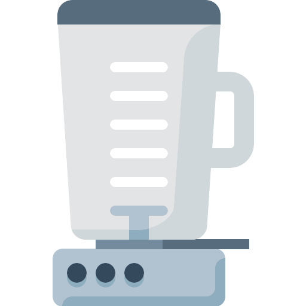

# automerj

[](https://github.com/LucianBuzzo/automerj/actions/workflows/ci.yml)

> A GitHub App built with [Probot](https://github.com/probot/probot) that Auto-merge your PRs once all required status checks pass

Usage
-----

After installing the app in your repository, any approved pull request that passes all checks will be merged automatically.

Installation
------------

```sh
# Install dependencies
npm install

# Run the bot
npm start
```

## Contributing

If you have suggestions for how automerj could be improved, or want to report a bug, open an issue! We'd love all and any contributions.

For more, check out the [Contributing Guide](CONTRIBUTING.md).

## License

[ISC](LICENSE) © 2020 Lucian Buzzo <lucian.buzzo@gmail.com>
